


# NonNet — Offline Bluetooth Messenger for iPhone, iPad & Mac

**Chat, send photos and videos with no internet, no Wi-Fi and no account. Works in airplane mode.**

---

**NonNet** is a free **offline messenger** that lets you **chat without internet** using only **Bluetooth**. Two iPhones, an iPhone and an iPad, or an iPhone and a Mac find each other automatically and talk directly, device to device. No SIM, no mobile data, no Wi-Fi network, no servers and no sign-up. Every conversation is **end-to-end encrypted**.

## ✨ Features

| | | |
|:--|:--|:--|
| 💬 **Messages & emoji** | 📷 **Photos** (camera or gallery, auto-compressed) | 🎬 **Videos** 360p, up to 10 s, 1x · 1.5x · 2x |
| 👁 **View once (1X)** photos and videos delete after viewing | ✓✓ **Read receipts** sent, delivered, seen | ❤️ **Reactions** double-tap or long-press |
| 🧭 **Compass radar** N · E · S · W with people nearby | 📏 **Live distance** Bluetooth, and centimeter-precise UWB on iPhone 11+ | 🔔 **Notifications** banner, sound and red badge |
| 🔒 **End-to-end encryption** X25519 + ChaChaPoly | 🕶 **Anonymous by default** optional nickname | ✈️ **Airplane mode** Bluetooth only, Wi-Fi off |

---

## ⚖️ NonNet vs other apps

| | **NonNet** | WhatsApp / Signal | iMessage | AirDrop | Bridgefy | Briar |
|:--|:--:|:--:|:--:|:--:|:--:|:--:|
| Works with **no internet** | ✅ | ❌ | ❌ | ✅ | ⚠️ internet needed once to sign up | ✅ |
| **No phone number or account** | ✅ | ❌ phone number | ❌ Apple ID | ✅ | ❌ account | ✅ |
| **Chat** | ✅ | ✅ | ✅ | ❌ files only | ✅ | ✅ |
| **Photos offline** | ✅ | ❌ | ❌ | ✅ | ❌ text only | ✅ |
| **Videos offline** | ✅ 360p | ❌ | ❌ | ✅ | ❌ | ❌ |
| **View once (1X)** | ✅ | ✅ online only | ❌ | ❌ | ❌ | ❌ |
| **Read receipts offline** | ✅ | ❌ | ❌ | ❌ | ❌ | ❌ |
| **Radar: direction & distance** | ✅ | ❌ | ❌ | ❌ | ❌ | ❌ |
| **iPhone & iPad** | ✅ | ✅ | ✅ | ✅ | ✅ | ❌ Android only |
| **Mac** | ✅ | ✅ | ✅ | ✅ | ❌ | ⚠️ desktop beta |
| **End-to-end encrypted** | ✅ | ✅ | ✅ | ✅ | ✅ | ✅ |

> **Where others win:** NonNet talks only to devices in direct Bluetooth range (~30–60 m). It doesn't relay messages through other phones the way mesh apps (Bridgefy, Briar) do, and it doesn't run on Android. Comparison based on public information, November 2026.

---

## 🌍 10 places where NonNet keeps you talking

### 1. Car to car on the highway

Driving together in a convoy? Send *"Exit 12?"* from one car to the other with no signal and no data plan. Phones in nearby cars connect over Bluetooth while you roll.

### 2. Two seats apart on a plane

Airplane mode on, Bluetooth on. Message your friend ten rows away without paying for in-flight Wi-Fi.

### 3. Festivals and concerts

Thousands of phones jam the mobile network. NonNet doesn't use it, so *"Front left!"* still arrives.

### 4. Hiking with zero signal

No towers in the valley? Stay in touch with the group, and the compass radar shows which way your friends are.

### 5. Underground in the metro

Between stations there's no coverage, but the phone two carriages down is still in Bluetooth range.

### 6. Blackouts and emergencies

When the network is down or overloaded, people nearby are still reachable. *"You OK?"* doesn't need a tower.

### 7. Abroad with no roaming costs

No local SIM and no roaming bill. Message your travel group for 0 €.

### 8. Same building: office, school, campus

iPhone to MacBook on the same floor or in the next room, without connecting to the building's Wi-Fi.

### 9. Private by design

No servers, no phone number, no email, no account. Messages go straight from device to device, encrypted, and are never uploaded anywhere.

### 10. At sea on a boat or ferry

Far from shore with no coverage? Chat between decks and cabins.

---

## ⚙️ How it works

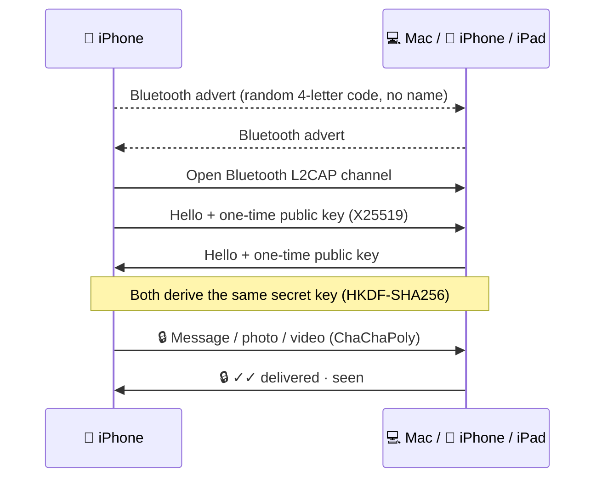

- **Discovery:** each device advertises a random code that changes on every launch. No name, no IP, no account.
- **Connection:** a direct Bluetooth Low Energy **L2CAP** channel. Wi-Fi and mobile data can be off.
- **Encryption:** a fresh key per connection, so every message, photo and video is encrypted end to end.
- **Radar:** distance comes from Bluetooth signal strength (±2–5 m). Between two iPhone 11 or newer it uses **Ultra Wideband**, accurate to centimeters with direction. Outdoors, shared GPS positions place people in their real compass direction.

## 📏 Range

| Situation | Typical range |
|:--|:--|
| Same room / apartment | ✅ always |
| Through one wall or floor | ✅ usually |
| Outdoors, line of sight | ~30–60 m |
| Through several concrete floors | ⚠️ weak |

Photos (~150 KB) take a few seconds over Bluetooth, and a 10 s 360p video takes ~10–30 s.

## 📲 Install

NonNet isn't on the App Store yet. Until then:

**Option A: SideStore (free, no Mac needed after setup)**
1. Install SideStore by following the guide at **sidestore.io** (needs a computer once).
2. Download `NonNet.ipa` from [Releases](../../releases).
3. In Safari: **Share → SideStore**, then NonNet installs.
4. Open SideStore once a week and tap **Refresh All**.

**Option B: build it yourself with Xcode (free Apple ID)**
1. `git clone https://github.com/CDAVIO/Nonnet-Messenger.git`
2. Open `Blip.xcodeproj` in Xcode.
3. **Signing & Capabilities → Team:** pick your Apple ID and change the Bundle Identifier.
4. Connect your iPhone, or pick **My Mac (Designed for iPad)**, then press **▶ Run**.

> With a free Apple ID, apps installed this way expire after 7 days. Re-install to renew.

**Requirements:** iOS / iPadOS 17 or newer · macOS 14 Sonoma or newer on a Mac with Apple silicon · Bluetooth on.

## 🔐 Privacy

- No servers, no analytics, no ads, no account.
- Chats live only in memory, and media is wiped when the app restarts.
- **1X** photos and videos are deleted from the receiver as soon as they're viewed.
- Your location is shared **only** with connected NonNet devices, and you can turn it off in Settings.

See [SECURITY.md](SECURITY.md) for the security model and how to report a vulnerability.

## ❓ FAQ

<b>Can I send messages without internet on iPhone?</b>

Yes. NonNet uses Bluetooth only, so it works with Wi-Fi off, mobile data off, or in airplane mode with Bluetooth on.

<b>Does it work between iPhone and Mac?</b>

Yes. NonNet runs on iPhone, iPad and Apple silicon Macs, and they all talk to each other.

<b>How far does Bluetooth messaging reach?</b>

About 10–30 m indoors and up to ~60 m outdoors with a clear line of sight.

<b>Does it work on Android?</b>

No. NonNet is built for Apple devices only.

<b>Do I get messages when the app is closed?</b>

If you just lock the phone or switch apps, yes: NonNet stays connected and shows a notification. If you force-quit it by swiping it away, iOS stops it until you open it again.

## 🛠 Built with

Swift · SwiftUI · CoreBluetooth (L2CAP) · CryptoKit · NearbyInteraction (UWB) · CoreLocation · AVFoundation · UserNotifications

## 📄 License

[MIT](LICENSE) © 2026 CDAV.IO

 

  

